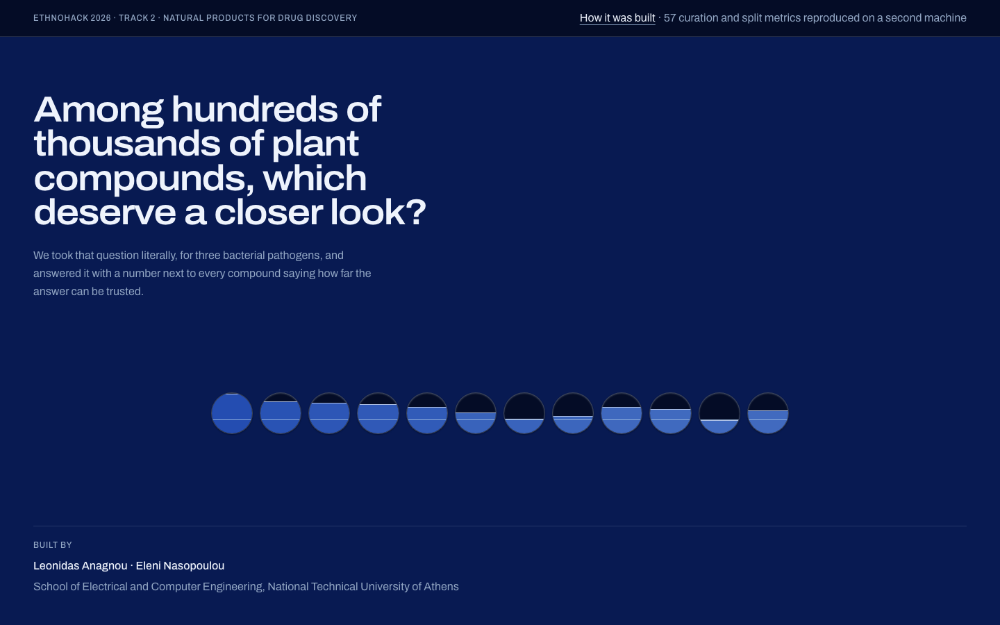

# Plant compounds, ranked against three bacterial pathogens

**Team Arxigoi · EthnoHack 2026 · Track 2: Natural Products for Drug Discovery**

Track 2 asks: *among hundreds of thousands of plant compounds, which deserve a
closer look?* We took the question literally. This repository trains one model
per bacterial pathogen on published MIC measurements, screens 97,709 plant
structures that have never been measured against anything, and returns a ranked
shortlist of 50 compounds per pathogen, each one carrying its source plant, its
literature reference, and its distance from anything the model was trained on.

The honest headline is not "50 drug candidates". It is a measured evaluation
ladder and a shortlist that declares its own limits.

> **Not a medical or clinical claim.** Everything here is a model prediction over
> published measurements and traditional-use records. Nothing has been near a
> laboratory. No dose, preparation or use is implied or recommended.



**Live site: <https://ethnohack-track2.vercel.app>** (no sign-in, no build step).

**Pitch video: <https://www.youtube.com/watch?v=igDx-wXzCYc>** (6 min 26 s).

The site has two pages. `/` is the deliverable: pick a pathogen, read the plate,
open a compound. `/pipeline` is the argument behind it, stage by stage, from the
Track 2 question to the run ledger. Slides are in
[`docs/deck/deck.pdf`](docs/deck/deck.pdf), with the narration in
[`docs/deck/narration.md`](docs/deck/narration.md).

---

## The problem

Published antibacterial measurements are overwhelmingly not about plants. Of the
58,191 compounds with a published MIC against *S. aureus*, only 1,424 come from a
plant. A model trained on that data and pointed at plant chemistry is being asked
to extrapolate, and most virtual-screening demos never measure how far.

So the question we actually answer is narrower and testable: **when you hold every
plant-derived compound out of training entirely, how well does the model still
rank them?**

## What it does

Three pathogens, one model each, chosen for three different cell envelopes so that
cross-reading between them means something:

| Pathogen | Envelope | Labelled compounds |
|---|---|---|
| *Staphylococcus aureus* | Gram-positive | 58,191 |
| *Escherichia coli* | Gram-negative | 43,099 |
| *Mycobacterium tuberculosis* | acid-fast | 22,907 |

### The evaluation ladder

The same model, read three ways. Only the last one is the question a plant screen
actually asks.

| | validation AUROC | scaffold-held-out test | **plant holdout** | plant 95% CI |
|---|---|---|---|---|
| *S. aureus* | 0.880 | 0.863 | **0.719** | 0.689–0.749 |
| *E. coli* | 0.882 | 0.903 | **0.682** | 0.609–0.750 |
| *M. tuberculosis* | 0.846 | 0.815 | **0.629** | 0.582–0.677 |

The ladder is not monotonic, since *E. coli* scores higher on the scaffold test
than on validation, but the plant holdout is the hardest reading for every
pathogen. That
is the number we report.

### What it buys a lab

Precision at the head of the ranking, against the base rate of picking at random:

| | precision @ top 10% | base rate | enrichment @ top 5% |
|---|---|---|---|
| *S. aureus* | 57.0% | 25.3% | 2.45× |
| *E. coli* | 29.9% | 9.0% | 5.03× |
| *M. tuberculosis* | 43.5% | 23.7% | 2.29× |

### Every score travels with its distance

No predicted probability is shown without the Tanimoto similarity to its nearest
training compound beside it. The applicability-domain cutoff (0.328) is the 25th
percentile of the plant holdout, the most distant set on which performance was
actually measured, not a number chosen for looks. Candidates beyond it are
published in a separate tier that says in its own words that its scores are not
evidence of activity.

### A finding we did not expect

The biosynthetic pathways of the shortlisted compounds track each pathogen's cell
envelope. Alkaloids and terpenoids dominate the acid-fast *M. tuberculosis* list
(30 of 50), peptides, sugars and fatty acids come up for Gram-negative *E. coli*
(21 of 50), shikimates and phenylpropanoids for Gram-positive *S. aureus* (19 of
50). The model was never given any cell-wall information.

We report this as **a hypothesis worth testing, not a finding**: it partly reflects
which compounds LOTUS has annotated.

### A negative result we are reporting anyway

We set out to show that holding out whole plant *families* is harder than holding
out chemical scaffolds. Measured four separate times, the direction is usually
negative and the magnitude never settles: *S. aureus* −0.073 (paired sd 0.067,
worse in 8 of 10 repeats), *E. coli* +0.004 (sd 0.139, 2 of 10, so the effect
vanishes), *M. tuberculosis* −0.097 (sd 0.158, 7 of 10). The repeat-to-repeat
spread is wider than the effect.

It goes in as an honest negative, not as our contribution.

## What is wrong with it

Stated in full on the site, and here:

- **The top-ranked candidate on all three plates is a near-copy of a training
  compound** (Tanimoto 0.986 / 0.982 / 0.976). Two of the three are non-plant
  polyketides of the same class, an anthracycline and a tetracycline, with no
  source plant and no DOI. The phenomenon this project measures shows up inside
  its own deliverable.
- **One row ships at Tanimoto 1.000**, correctly flagged in the shortlist as a
  fingerprint twin of a training compound rather than removed from it.
- **Plant provenance is incomplete.** 12 / 8 / 3 of the 50 candidates per plate
  carry no source plant and no reference, and 15 / 8 / 3 carry no plant family.
  DOI coverage is 38 / 42 / 47 of 50.
- **Per-compound SHAP values are withheld.** The values written alongside the
  shortlists are numerically impossible for a probability output, so they are
  excluded until the cause is found. The aggregate importances are sound.
- **There is no protein-level target.** 99.6% of the ChEMBL MIC rows in our pull,
  across nine bacteria, are measured against the whole organism, and only 35
  single-protein targets carry any MIC at all. The model predicts growth
  inhibition and says nothing about mechanism.
- **Nothing has been experimentally validated.**

---

## Run it

No API keys, no accounts, no `.env`. Nothing in this repository requires a secret.

### The web app

The site reads the committed files in `results/` at build time and exports as a
static site with no backend.

```bash
cd web && npm install && npm run dev
```

Then open <http://localhost:3100>. `npm run build` writes a static export to
`web/out/`.

The same build is already deployed at
<https://ethnohack-track2.vercel.app>, so you can read the shortlists without
running anything.

### The pipeline

Python 3.12+, managed with [uv](https://docs.astral.sh/uv/).

```bash
uv sync
```

Download the source data (all resumable: rerun to continue an interrupted
download; `ETHNOHACK_DATA_DIR` moves the location):

```bash
uv run python scripts/fetch_lotus.py && uv run python scripts/fetch_taxonomy.py && uv run python scripts/fetch_chembl.py MIC
```

Then run the notebooks in order, `01` through `05`. Each saves what the next one
loads, so nothing is recomputed. See [notebooks/README.md](notebooks/README.md).

The unit tests cover the two places a silent error would be most expensive: the
unit conversion and censored-value rules in `pipeline/labels.py`, and the
cluster-level splitting in `pipeline/splits.py`. They need no downloaded data:

```bash
uv run pytest
```

## What is in here

| Path | What it holds |
|---|---|
| [`notebooks/`](notebooks/README.md) | the pipeline, one stage per notebook, `01` to `05`, with shared code in `notebooks/pipeline/` |
| [`scripts/`](scripts/) | data downloads and standalone experiments |
| [`results/`](results/) | the shortlists, the exploratory tier, and `runs.jsonl`, every metric with the configuration hash that produced it |
| [`web/`](web/README.md) | the public site: `/` is the shortlists, `/pipeline` is the argument behind them |
| [`docs/`](docs/) | [data sources and licences](docs/data-sources.md), the proposal, the deck and the narration |

## Technologies

Python, RDKit, scikit-learn, XGBoost, Optuna, SHAP, pandas, NumPy, Matplotlib.
Next.js, React, Tailwind CSS and smiles-drawer for the site. Everything is pinned
in `pyproject.toml` and `web/package.json`.

## Data sources and licences

| Source | Used for | Licence |
|---|---|---|
| [ChEMBL](https://www.ebi.ac.uk/chembl/) | measured antibacterial activity (MIC) | CC BY-SA 3.0 |
| [LOTUS](https://lotus.naturalproducts.net/) | the plant-to-compound edge, with references | CC0 |
| [GBIF backbone](https://www.gbif.org/) | independent check on which organisms are plants | CC BY-NC 4.0 |

**NPASS was evaluated and dropped.** Its MIC table is a copy of ChEMBL (40 of 40
sampled compounds found in ChEMBL, 39 of 40 matching to three significant figures)
and it publishes no licence, so we cite ChEMBL directly.
`scripts/fetch_npass.py` is kept only as the record of that check.

No data is committed. `scripts/` downloads all of it into `data/`, which is
gitignored. Full detail in [docs/data-sources.md](docs/data-sources.md).

## Reproducibility

Every model and evaluation metric on the site and in this README is read from
`results/runs.jsonl`, which records the configuration hash behind each of the 22
named runs. The exception is the data survey on `/pipeline` (the 99.6%, the
censoring and threshold shares): notebook 01 writes no ledger entry, so those
figures are literals in the page. Nothing else is typed in by hand.

The curation and split stages were re-run end to end from the raw downloads on a
second machine, and all **57** ledger metrics matched to the last decimal. **The
model and shortlist stages have not been reproduced that way**, and the ledger
records that stages were run with the working tree dirty, which is why we quote
configuration hashes rather than commits.

## What existed before the hackathon

Nothing in this repository. It was created on 2 November 2026 and everything here
was built during the event (2–8 November 2026). The project design draws on prior
unpublished work by one of us on antimicrobial-peptide screening pipelines; no
code, data or text from that work is in this repository.

## Use of AI tools

Claude (Anthropic) was used throughout, as a pair programmer and writing
assistant: scaffolding the notebooks and the shared `notebooks/pipeline/` modules,
building the web app in `web/`, drafting documentation including this README, and
reviewing decisions. Every modelling and curation decision, every number reported,
and the final text are ours; we checked the outputs and are responsible for their
accuracy, originality and licensing. Several claims were corrected against the run
ledger during review.

## Responsible use

The plant records come from published literature, and traditional knowledge sits
behind many of them. Anything built on this carries the
[Nagoya Protocol](https://www.cbd.int/abs/) and
[Local Contexts](https://localcontexts.org/) as a condition of using the data, not
as a footnote.

Output on the site is stated as predicted or traditional-use claims. It is not
evidence of efficacy and is not medical advice.

## Team

**Team Arxigoi.**

**Leonidas Anagnou**: data, curation and the plant-side join and screen.
**Eleni Nasopoulou**: features, splits, models, evaluation and the applicability
domain.

Both at the School of Electrical and Computer Engineering, National Technical
University of Athens.

## Licence

[MIT](LICENSE). The data sources keep their own licences, listed above. The
typefaces used by the site and the deck, Archivo and Martian Mono, are under
the [SIL Open Font License](https://openfontlicense.org/).
